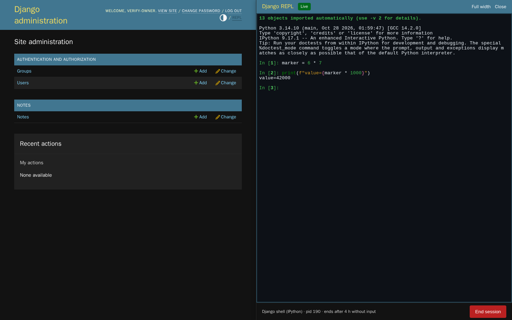

# Design

The explicitly chosen appearance is stock Django admin. Authority order: that choice, then usability and
accessibility, then the house design foundation. There is no new theme, font or design system. The
representative screen is the real admin with the drawer docked beside a change list.

## Decisions

| Area | Decision | Status |
| --- | --- | --- |
| Entry point | A **REPL** button in the admin user tools, styled like the neighboring links, with a 16 px terminal icon (inline SVG in `currentColor`, `aria-hidden`, so the accessible name stays "REPL"), plus <kbd>Ctrl</kbd>+<kbd>`</kbd> anywhere. | decided |
| Side | `ADMIN_REPL["SIDE"]`, `"right"` by default or `"left"`. It is a site setting, not a per-user toggle: the admin layout around the drawer should not move between users of one site. The template passes it to `boot.js`, which sets `html.admin-repl-left` before first paint, and to the drawer's `data-side`. CSS mirrors the position, border, shadow, slide direction, page padding and separator; `drawer.js` mirrors drag and arrow-key direction. | decided |
| Placement | Fixed drawer on the configured side. Its width is the user's (default `min(48rem, 50vw)`), clamped by CSS between 360 px and the viewport minus 400 px. From 760 px wide it docks: the page gets matching padding on that side, so list and change pages stay usable beside it. Below 760 px there is no room for both, so it overlays at full width and cannot be resized. | decided |
| Resizing | The drawer's inner edge (left for a right-hand drawer, right for a left-hand one) is a window splitter: `role="separator"`, focusable, `aria-valuenow`, `-valuemin` and `-valuemax` in px. Drag it with a pointer, or Tab to it (it sits just before **Full width**) and use <kbd>←</kbd>/<kbd>→</kbd> (16 px; the arrow moves the edge, so <kbd>←</kbd> widens a right-hand drawer and narrows a left-hand one), <kbd>Shift</kbd> with an arrow (80 px), <kbd>Home</kbd> (narrowest) and <kbd>End</kbd> (widest). A grip in `--body-quiet-color` sits mid-edge with a `col-resize` cursor and turns `--primary` on hover, focus and drag. The drag uses pointer capture, sets `user-select: none` on the page and cancels `mousedown`, so it never selects admin or terminal text and focus stays in the terminal. | decided |
| Width bounds | 360 px keeps about 43 terminal columns. 400 px keeps a phone-sized admin page. Admin content wider than its area (a change list with its filter while the nav sidebar is open) is clipped at the drawer edge by `overflow-x: clip` on `#container`, instead of sliding under the drawer or scrolling the page sideways; narrowing the drawer or collapsing the sidebar brings it back. A width that stops fitting after a window resize is clamped by CSS and returns when the window grows. | decided |
| Live terminal resize | The width change resizes the screen element, the `ResizeObserver` refits Ghostty, and `onResize` sends the new grid to the server, which applies it to the PTY. 250 ms after the last grid change, if anything was written, the drawer resets the terminal and re-attaches at byte 0 on the same socket, so the retained output replays at the new size (see Ghostty Web notes). The process and its variables stay. | decided |
| Width memory | One number, `admin-repl:width` in `localStorage`, so the chosen width follows the user across admin pages, reloads, tabs and browser restarts. `boot.js` applies it before first paint. A stored value that is not a positive number is ignored. Open state and full width stay per tab in `sessionStorage`, because a drawer opening by itself in every new tab would be surprising. | decided |
| Docked page layout | While docked, the admin `#container` drops its 980 px `min-width`, and the dashboard uses the admin's own single-column rules from `responsive.css`. Without this the page slid under the drawer (seen in the first screenshots). | decided |
| Full width | A header toggle switches the drawer to 100 vw and hides the separator, since the inner edge is the window edge. Switching back restores the chosen width. Close removes the page padding and keeps the width for the next open. The toggle and the open state persist per tab (`sessionStorage`) and are applied before first paint by `boot.js`, so navigation does not flash. | decided |
| Colors | Chrome uses only admin CSS variables (`--header-bg`, `--header-color`, `--body-bg`, `--hairline-color`, `--message-*-bg`, `--delete-button-bg`). It follows admin light, dark and auto themes with no extra rules. | decided |
| Terminal | Always dark (`#0d1117` background, GitHub-dark ANSI palette), so the terminal starts dark in every admin theme. The cursor uses the admin primary `#79aec8`. | decided |
| Type | The terminal uses the admin `--font-family-monospace` stack at 13 px. No web fonts are loaded. | decided |
| Controls | Native admin `.button` and `.button.default` for Start; End uses the admin delete color. Header actions are link-style buttons like the user tools. | decided |
| States | A pill shows Not started, Connecting, Live, Disconnected, Ended, Exited, Expired or Not authorized. A notice line under the header gives the reason, for example the idle limit, a lost earlier session, or output that was not retained. | decided |
| Motion | 160 ms slide on open. `prefers-reduced-motion: reduce` removes the transition. | decided |
| Focus | Opening moves focus to the terminal (or to the interpreter select when nothing runs). Closing returns focus to the REPL button. <kbd>Escape</kbd> closes when focus is on drawer chrome; inside the terminal it belongs to the program. <kbd>Tab</kbd> inside the terminal is completion. | decided |
| Docked width trade-off | At 1440 px the default leaves the page 720 px. The user trades space between the two by dragging; collapsing the admin nav sidebar, **Full width** or **Close** give more room. | decided |
| Accessibility gap | The Ghostty canvas is not readable by screen readers. State changes are announced through the notice's `role="status"` live region. | known gap |

## Ghostty Web notes

- `ghostty-web` 0.4.0 calls `attachCustomKeyEventHandler` handlers and treats `true` as "consumed". This is
  the opposite of xterm.js. An xterm-style handler swallowed every key in the first browser run, so the
  drawer catches <kbd>Ctrl</kbd>+<kbd>`</kbd> in the document capture phase and installs no custom handler.
- `Terminal.write` answers terminal queries synchronously. Replayed history is written with input forwarding
  suspended, so old queries cannot type replies into the live REPL.
- The WASM is fetched from the app's own static files with `Ghostty.load(<static url>)`, not the base64 copy
  inlined in the bundle.
- Defect in `ghostty-web` 0.4.0, worked around: when the grid widens after output, the reflow in
  `ghostty_terminal_resize` leaves stale WASM memory in the cells of the first rows. The browser check
  `widen-rows` reproduces it on a fresh server with plain Python output: after **Full width** (86 to 176
  columns) the buffer's rows 0 and 1 hold runs of steadily increasing code points (U+B9B0 onward, then planes
  1 and 2), which is memory, not output. The cells themselves are wrong, not just the canvas. The drawer now
  rebuilds the screen from the server's output log once the grid settles: `term.reset()` (a fresh WASM
  terminal at the new size) and a re-attach at byte 0. With that, `widen-rows` finds every earlier row
  unchanged. The server keeps one stream task per socket, so re-attaching never runs two feeds. The cost is a
  replay of up to `REPLAY_BYTES` per settled resize. An upstream report with a bare-`Terminal` byte stream is
  still to be filed. Open limit: the replay re-sends bytes that programs drew for earlier grid sizes. IPython's prompt
  redraws after each resize move the cursor by rows computed for the old width, so after several resizes the
  rows above the prompt can show text fragments (seen in `resize-wide-1440.png`, taken right after a drag, and in
  a left-side run after keyboard resizes). Plain-Python output replays intact (`widen-rows`).
- Not a defect: the earlier "plain Python as the first session of a cold server shows no output" came from the
  browser check, not the product. Ghostty's `translateToString(true)` trims trailing spaces, so a fresh
  `>>> ` prompt row reads `>>>` and never matched the needle `">>> "`. A reproduction on a fresh server showed the
  banner and one `>>>` row per typed Enter, with the server at 508 bytes and the client cursor at 508. Why the
  same needle matched when Python started after IPython in the main journey was not established. The checks now
  wait for `>>>`, and the `cold-python` check starts plain Python first on a fresh server.

## Review

Captured in Chromium 153 by `scripts/verify.sh` in throwaway containers with generated accounts and synthetic
data. Committed copies are in [docs/screenshots/](docs/screenshots/) with PNG metadata stripped; screenshots taken before the widening fix were removed because they showed its corrupted rows. Each gate run writes fresh
copies, including the expired state, to its artifacts directory.

| Check | Result | Evidence |
| --- | --- | --- |
| Wide 1440×900, admin dark, live IPython session, right-hand drawer | pass | `drawer-right.png` |
| Left-hand drawer at 1440 and 960 px, page beside it, PTY columns follow | pass | checks `left-*`; `left-side-1440.png` and `left-side-960.png` in the gate run directory |
| Wide, full-width terminal (176 columns), earlier rows intact | pass | check `widen-rows`; `cold-python-full-width.png` in the gate run directory |
| Narrow 390×844, drawer at 390 px | pass | `owner-narrow-dark.png` in the gate run directory |
| Admin light theme, terminal stays dark | pass | `owner-desktop-light.png` in the gate run directory |
| Expired state after the idle limit | pass | browser idle phase; `owner-expired.png` in the gate run directory |
| Session lost after a server restart | pass | `owner-after-restart.png` |
| Keyboard: toggle, <kbd>Ctrl</kbd>+<kbd>`</kbd>, focus return on close | pass | browser journey assertions |
| Reduced motion: `transition-duration` is `0s` | pass | browser journey assertion |
| Fonts actually used | system monospace from the admin stack, no downloads | request log has no font URLs |
| Wide 1440×900, drawer dragged to its 1040 px limit beside a 400 px change list; overflow clipped at the edge | pass | `resize-wide-1440.png` in the gate run directory |
| 960×800, drawer at 480 px after dragging to the 360 px minimum and back; grip mid-edge | pass | `resize-narrow-960.png` in the gate run directory |
| Separator focused from the keyboard: focus ring and grip in the admin primary color | pass | `resize-keyboard-focus.png` in the gate run directory |
| Drag and keyboard resize, bounds, width memory, PTY columns in the live session | pass | checks `resize-drag-wide`, `resize-drag-narrow`, `resize-keyboard`, `resize-persistence`, `resize-live-terminal`, `left-drag`, `left-keyboard` |
| Matched-state comparison with a reference | n/a | no earlier design exists |

