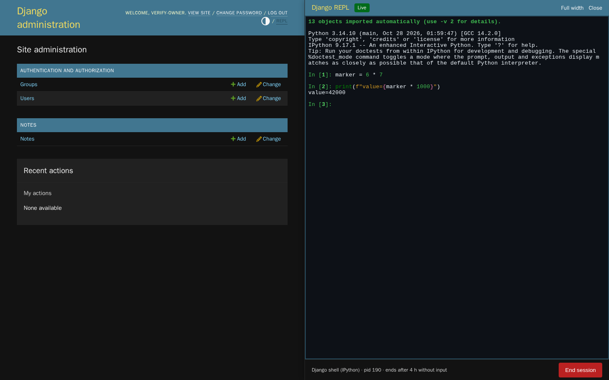

# django-admin-repl

A real Django shell in a side drawer of the stock Django admin, for superusers who would otherwise open an
SSH session to run `manage.py shell`.

The drawer opens on any admin page. Inside it, [Ghostty Web](https://github.com/coder/ghostty-web) (Ghostty's
terminal emulator compiled to WebAssembly) renders a `django-admin shell` process that runs in a pseudo-terminal
on the server. The process belongs to the server, not the page: moving between admin pages or reloading
reattaches to the same live interpreter, with its variables intact.



> **Preview.** This is public source for an early release. It is not on PyPI, it runs on Linux only, and it
> hosts sessions in a single server process. Read [Security](#security) before you enable it anywhere but
> your own machine.

## Features

- A **REPL** link with a terminal icon in the admin user tools, or <kbd>Ctrl</kbd>+<kbd>`</kbd>, opens the drawer.
- The drawer docks on the right by default, or on the left with `ADMIN_REPL["SIDE"] = "left"`. The admin page
  stays usable beside it. Below 760 px it covers the page at full width.
- Drag the drawer's inner edge, or Tab to it and use the arrow keys, Home and End, to set its width. The width
  is remembered in the browser. The terminal and the server's pseudo-terminal follow every change live.
- **Start session** launches an interpreter from a server-side list: Django's `shell` with plain Python or
  IPython, or django-extensions `shell_plus`. Rendering a page never starts a process.
- Typing, paste, <kbd>Ctrl</kbd>+<kbd>C</kbd>, colors and completion behave like a local terminal.
- **Close** hides the drawer and keeps the process. **End session** terminates the process tree.
- After navigation, reload or a dropped connection the drawer replays recent output exactly once and says so
  when older output was not retained.
- A session with no input for `IDLE_TIMEOUT` seconds (default 4 hours) is ended and shown as expired.
- Only authenticated, active superusers see the drawer, and each reaches only their own session.

There is no AI integration, SQL console, operating-system shell or separate management-command runner. To run
a management command, call it from the REPL:

```python
from django.core.management import call_command

call_command("check")
call_command("showmigrations", "auth")
```

## Quickstart: the demo project

The demo is a Django 6.1 project with one model of synthetic notes. It needs Python 3.12 or newer on Linux.

<!-- quickstart -->
```bash
git clone https://github.com/dmmeteo/django-admin-repl.git
cd django-admin-repl
python3 -m venv .venv
. .venv/bin/activate
pip install -r requirements/demo.txt
pip install --no-deps -e .
scripts/demo.sh
```

Open <http://127.0.0.1:8000/admin/> and log in as `admin`. The generated password is in
`demo/.data/login.json`. `scripts/demo.sh` serves on loopback only and keeps its state in `demo/.data/`: the
SQLite database, the secret key and that login. Stop it with <kbd>Ctrl</kbd>+<kbd>C</kbd>; running it again
keeps your data and password. A restart ends any REPL session, because Python state lives in the server process.

`requirements/demo.txt` pins Django, Channels, Daphne, IPython and django-extensions with hashes. The package
itself depends only on Django and Channels.

## Add it to an existing project

Requirements: Python 3.12+, Django 5.2, 6.0 or 6.1, Channels 4, an ASGI server (tested with Daphne), Linux,
and **one** server process (see [Limitations](#limitations)).

Install from GitHub with ordinary pip. Add `[ipython]` for the IPython interface and `[shell-plus]` for
django-extensions `shell_plus`:

```bash
pip install "django-admin-repl[ipython] @ git+https://github.com/dmmeteo/django-admin-repl.git"
```

Installing the package changes nothing on its own. The REPL is **enabled** only after these four steps, and
then only for active superusers.

1. Settings:

   ```python
   INSTALLED_APPS = [..., "django_admin_repl"]
   ADMIN_REPL = {"IDLE_TIMEOUT": 60 * 60}  # optional, see Settings
   ```

2. URLs, before the admin's own patterns:

```python
from django.contrib import admin
from django.urls import include, path

urlpatterns = [
    path("admin/repl/", include("django_admin_repl.urls")),
    path("admin/", admin.site.urls),
]
```

3. ASGI routing for the terminal stream:

   ```python
   from channels.auth import AuthMiddlewareStack
   from channels.routing import ProtocolTypeRouter, URLRouter
   from channels.security.websocket import AllowedHostsOriginValidator
   from django.core.asgi import get_asgi_application

   django_asgi_app = get_asgi_application()

   from django_admin_repl.routing import websocket_urlpatterns  # noqa: E402

   application = ProtocolTypeRouter(
       {
           "http": django_asgi_app,
           "websocket": AllowedHostsOriginValidator(AuthMiddlewareStack(URLRouter(websocket_urlpatterns))),
       }
   )
   ```

4. The admin template, `templates/admin/base_site.html`:

   ```django
   
   
   {{ block.super }}
   {{ block.super }}
   {{ block.super }}
   ```

Run `python manage.py check`. Misconfigured settings and unavailable backends are reported as
`admin_repl.E001` and `admin_repl.E002`.

## Settings

```python
ADMIN_REPL = {
    "BACKEND": "auto",  # default interpreter: "auto", "python", "ipython" or "shell_plus"
    "ALLOWED_BACKENDS": None,  # None offers every available backend, or a list of names
    "IDLE_TIMEOUT": 4 * 60 * 60,  # seconds without owner input before the process is ended
    "REPLAY_BYTES": 512 * 1024,  # output kept per session for reload and reconnect
    "STREAM_PATH": "/admin/repl/stream/",  # must match the websocket route
    "LOCK_PATH": None,  # defaults to <tempdir>/django-admin-repl.lock
    "SIDE": "right",  # "right" or "left"
}
```

| Backend | Runs | Offered when |
| --- | --- | --- |
| `python` | `django-admin shell --interface python` | always |
| `ipython` | `django-admin shell --interface ipython` | IPython is installed |
| `shell_plus` | `django-admin shell_plus` (IPython when installed, plain otherwise) | `django_extensions` is in `INSTALLED_APPS` |

`auto` prefers IPython, then plain Python. An explicitly configured backend that is unavailable fails the
system check instead of being replaced.

## Supported versions

Every combination below runs the full test suite against real pseudo-terminal processes in
`scripts/verify.sh` and in [CI](.github/workflows/ci.yml):

| | Django 5.2 LTS | Django 6.0 | Django 6.1 |
| --- | --- | --- | --- |
| Python 3.12 | tested | tested | tested |
| Python 3.13 | tested | tested | tested |
| Python 3.14 | tested | tested | tested |

Pinned patches: Django 5.2.18, 6.0.9, 6.1.2, Channels 4.3.2. The browser journeys run with Python 3.14,
Django 6.1 and Chromium 153. Older Python and Django releases are not supported. Windows and macOS are not
supported: sessions need Linux pseudo-terminals and `/proc`.

## Security

The REPL is arbitrary code execution with the permissions of your web server process. Treat enabling it like
handing out a shell on that server.

- Enable it only where every active superuser may run any code as the server user, read its environment and
  settings (including `SECRET_KEY` and database credentials) and reach whatever the server can reach.
- Serve the admin over HTTPS. Keep the admin behind the same protections you would give an SSH endpoint.
- Contain the process at the operating-system level: a dedicated user, a container or VM, a read-only root
  filesystem where practical, and network egress limits. Python offers no sandbox here.
- Process access is checked on every request and stream: only an authenticated, active superuser, only their
  own session. A live stream re-reads the Django session every 10 s and closes after logout, deactivation or
  a password change. The browser sends only a backend name from the server's list; no command line, path or
  shell string from a request is ever executed.
- Idle expiry counts only the owner's input, so an open tab does not keep a process alive.

Report vulnerabilities privately as described in [SECURITY.md](SECURITY.md).

## Limitations

- Sessions live in memory in one ASGI server process. A second process that tries to host sessions is refused
  through a lock file, so run one worker. A restart ends every session, and the drawer says the old one is gone.
- Python state does not survive a restart, a deploy or the idle limit.
- Replay keeps the last `REPLAY_BYTES` of output per session. Older output is reported as not retained.
- Each time the terminal's column count changes, the drawer clears the screen and replays the retained output
  at the new size. This works around a defect in the vendored `ghostty-web` 0.4.0, which leaves stale memory in
  rows it reflows. A long scrollback replays briefly. Output that a program drew for an earlier size is replayed
  as it was sent: after several resizes, IPython's prompt redraws can leave fragments in rows above the prompt.
- Interpreter switching happens at session start. A live process cannot change interpreter.
- The terminal canvas is not exposed to screen readers. Session state changes are announced in a live region.
- Below 760 px the drawer covers the page and cannot be resized.
- Descendant processes that drop the session marker from their environment and leave the process group can
  outlive **End session** until the server process stops.
- Tested in Chromium only.

## Development

```bash
bash scripts/verify.sh
```

`scripts/verify.sh` is the release gate. It needs Docker and network access to PyPI and npm for the image
builds. Each stage runs in a capped, non-root container:

1. Ruff check and format check, and the ty type check of `src/`.
2. The pytest suite with real pseudo-terminal processes in every Python and Django combination above.
3. A wheel and sdist build, a check of what they ship, and clean `pip install`s with and without extras.
4. The quickstart above, run verbatim in a clean copy, including a restart.
5. Playwright journeys in Chromium against throwaway demo containers on an internal network: both drawer
   sides, wide and narrow windows, reload, restart, idle expiry, permissions and the terminal resize path.

On a busy machine, `ADMIN_REPL_CI_MEMORY` (default `1536m`), `ADMIN_REPL_BROWSER_MEMORY` (`1g`) and
`ADMIN_REPL_MATRIX_JOBS` (`3`) lower the container caps and the parallel matrix cells.

For a quicker loop, any virtual environment works; [uv](https://docs.astral.sh/uv/) is optional:

```bash
python3 -m venv .venv && . .venv/bin/activate
pip install -c requirements/matrix.txt -r requirements/dev.txt Django==6.1.2 channels daphne ipython \
    django-extensions pytest pytest-django
pip install --no-deps -e .
ruff check . && ruff format --check . && ty check src
DEMO_DATA_DIR=$(mktemp -d) PYTHONPATH=demo:tests python -m pytest
```

Run the pytest command from a fresh `DEMO_DATA_DIR` after `python demo/manage.py migrate` and
`python demo/manage.py seed_demo` with the same variables; the interpreter tests read the demo notes.

Type checking covers `src/` with ty against the installed Django and Channels sources. The two places where
Django's runtime typing is wider than its declared types are named, not suppressed:
`access.AuthenticatedRequest` declares the `user` that `AuthenticationMiddleware` adds, and `repl_owner()`
narrows a user to an active superuser's primary key. `tests/` and `demo/` are not gated: the demo's
`Note.objects` is added by Django's model metaclass, which ty resolves only with a stub package such as
`django-types`.

[DESIGN.md](DESIGN.md) describes the drawer, [docs/spec.md](docs/spec.md) the scope and invariants, and
[docs/adr/](docs/adr/README.md) the decisions.

## Related

- [django-extensions-admin](https://github.com/dmmeteo/django-extensions-admin), the admin core library by the
  same author. A future `django-extensions-admin[repl]` extra may bundle this app. Today the two are
  independent packages, and installing one does not install or enable the other.

## License

MIT, see [LICENSE](LICENSE). The vendored `ghostty-web` 0.4.0 under
`src/django_admin_repl/static/admin_repl/vendor/ghostty-web/` keeps its own MIT license and provenance notes.
